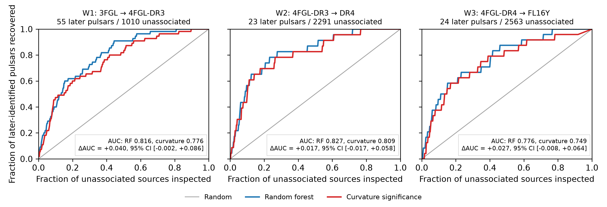

# Does Machine Learning Beat Spectral Curvature at Finding New Fermi Pulsars?

A pre-registered, temporal-holdout evaluation of pulsar-candidate rankings for unassociated Fermi-LAT gamma-ray sources.

[](https://doi.org/10.5281/zenodo.24586950)

> **Correction (2026-11-27).** Earlier versions of this repository reported a 98.84% balanced accuracy for a
> 5-class random forest on 4FGL-DR4. **That figure is an artifact**: SMOTE was applied to the full data set before
> cross-validation, so most validation rows were synthetic interpolations of training sources.
> With resampling done inside the folds and scoring only real held-out sources, the balanced accuracy is **0.498 ± 0.001**
> ([`audit/leakage_check.py`](audit/leakage_check.py)). The outputs of that pipeline are listed under [Legacy material](#legacy-material)
> and should not be used for science.

## Question
Radio and gamma-ray pulsation searches prioritise unassociated Fermi-LAT sources using either a machine-learning (ML) "pulsar-likeness" score
or the physical cue those scores mostly rely on: **spectral curvature**.
We ask whether an ML ranking recovers pulsars that were identified **in later catalog releases** better than ranking by curvature significance alone.

## Design (pre-registered in [`PROTOCOL.md`](PROTOCOL.md); git tags `protocol-v1` and `protocol-v2`)
Each window trains only on the earlier release (its associations and features). It then scores that release's unassociated sources, and checks which of them became pulsars (`msp`/`psr`) later.

| Window | Train on | Ranked pool | Later-identified pulsars |
|---|---|---|---|
| W1 | 3FGL | 1,010 unassociated | 55 (by 4FGL-DR3) |
| W2 | 4FGL-DR3 | 2,291 unassociated + unk | 23 (by 4FGL-DR4) |
| W3 | 4FGL-DR4 | 2,563 unassociated + unk | 24 (by FL16Y, the preliminary 5FGL list) |

- **The windows are disjoint**, giving 102 independent positives in total.
- **Rankers:**
  - a random forest (RF) with fixed hyperparameters and no tuning on any holdout;
  - curvature significance alone (`LP_SigCurv`, or `Signif_Curve` for 3FGL);
  - secondary rankers.
- **Metric:** ROC AUC of the later pulsars against the rest of the pool, plus recall in the top 5% and 10%. The 95% CIs come from a paired stratified bootstrap (10,000 resamples).
- **Pre-registration:** W1 and W2 were fixed before any result was computed.
  W3 (`protocol-v2`) was written after W1/W2 and before any W3 score, as a confirmatory test of a pattern seen in W1/W2.
  Its positive list was committed before scoring.

## Results
| Window | AUC RF | AUC curvature | ΔAUC (RF − curvature), 95% CI |
|---|---|---|---|
| W1: 3FGL → DR3 | 0.816 | 0.776 | +0.040 [−0.002, +0.086] |
| W2: DR3 → DR4 | 0.827 | 0.809 | +0.017 [−0.017, +0.058] |
| W3: DR4 → FL16Y | 0.776 | 0.749 | +0.027 [−0.008, +0.064] |
| W3, MSPs only (confirmatory H2) | 0.811 | 0.794 | +0.017 [−0.013, +0.049] |

1. **The ML ranking is at best marginally better than curvature significance.** It has the higher point estimate in all three windows,
   but no 95% CI excludes zero, and the upper bounds rule out an advantage larger than about 0.09 AUC.
2. **In-distribution validation overstates real performance.** Cross-validated on associated sources, the RF reaches an AUC of 0.98.
   On pulsars identified later it reaches 0.78–0.83.
3. **An apparent MSP-specific advantage in W1 (+0.09) was not confirmed** in the pre-registered W3 test, whose upper bound is +0.049.
   A flux-independent shape ranker (`LP_beta`) did worse than curvature significance.
4. **Sensitivity analyses agree.** The conclusions hold when RF-targeted (TRAPUM) discoveries are excluded,
   and when only pulsation-confirmed positives are kept.



Full numbers are in [`results/holdout_results.json`](results/holdout_results.json) (W1, W2) and [`results/w3_results.json`](results/w3_results.json) (W3).
The figure is rebuilt from the saved scores with `python -m src.make_figure`. The W3 MSP-only curve is in `results/w3_recovery_msp.png`.

## Reproduce
```
python -m venv .venv
.venv/Scripts/python -m pip install -r requirements.txt          # exact environment: audit/env_freeze.txt
```
Download the public FSSC catalogs. Every loader verifies the SHA256 below.

| Catalog | Path | Source | SHA256 |
|---|---|---|---|
| 3FGL (v16) | `data/3fgl/gll_psc_v16.fit` | [4yr_catalog](https://fermi.gsfc.nasa.gov/ssc/data/access/lat/4yr_catalog/gll_psc_v16.fit) | `527fc8e2…` |
| 4FGL-DR3 (v31) | `data/dr3/gll_psc_v31.fit` | [12yr_catalog](https://fermi.gsfc.nasa.gov/ssc/data/access/lat/12yr_catalog/gll_psc_v31.fit) | `57b09238…` |
| 4FGL-DR4 (v35) | `gll_psc_v35.fit` | [14yr_catalog](https://fermi.gsfc.nasa.gov/ssc/data/access/lat/14yr_catalog/gll_psc_v35.fit) | `e3b3ea27…` |
| FL16Y (v41) | `data/fl16y/gll_psc_v41.fit` | [fl16y](https://fermi.gsfc.nasa.gov/ssc/data/access/lat/fl16y/gll_psc_v41.fit) | `057fc22a…` |

The full hashes are in [`src/config.py`](src/config.py). Then:
```
.venv/Scripts/python -m pytest -q tests          # 13 tests
.venv/Scripts/python -m src.run_cv               # training-release CV diagnostic
.venv/Scripts/python -m src.run_holdout          # W1, W2
.venv/Scripts/python -m src.curate_w3            # W3 positives + sensitivity flags (no scores)
.venv/Scripts/python -m src.run_w3               # W3
.venv/Scripts/python audit/leakage_check.py      # reproduces 0.988 (leaky) vs 0.498 (correct)
```
**Reproducibility check.** These steps were run from a fresh extraction of the release archive.
All reported metrics, CIs, verdicts and the positive list came out identical. The raw random-forest probabilities
in `results/holdout_scores_*.csv` differ by at most 3×10⁻¹⁶, because multithreaded tree averaging rounds in a different order.
Every ranking, and so every result, is unchanged.

## Repository layout
- [`src/`](src/): the analysis pipeline (loaders, upper-limit-aware features, windows, rankers, statistics).
- [`tests/`](tests/): tests for the feature logic, the metrics and the window invariants.
- [`results/`](results/): outputs of the one-shot runs.
- [`PROTOCOL.md`](PROTOCOL.md): the pre-registration, with its deviations log in §9.
- [`audit/`](audit/): the leakage audit, the temporal-window census and the exact package versions.
- [`literature_notes.md`](literature_notes.md): the related-work and novelty check.

## Legacy material
These files come from the original hierarchical-classification pipeline and are kept for transparency. They are **superseded**:
- `main.ipynb` and `data_extraction.ipynb`. The notebook depends on a deleted cell and cannot be re-run top to bottom.
- `4fgl_final_master_catalog.csv` and `4fgl_resolved_bcus.csv`.
- `4fgl_rf_model.joblib`, `scaler.joblib` and `label_encoder.joblib`.
- `confusion_matrix.png`, `feature_importances.png` and `spatial_distribution_map.png`.

Their performance claims are invalid (see the correction above), and their confidence scores are uncalibrated.
They are **excluded from the Zenodo archive** (via `.gitattributes` export-ignore) and remain available in this repository's history.
The leakage audit does not need them: its inputs, the legacy pipeline's own feature tables, are frozen with checksums in `audit/inputs/`.

## Citation and license
The citable record is the versioned Zenodo archive, **v1.0.0: [doi:10.5281/zenodo.24586950](https://doi.org/10.5281/zenodo.24586950)**
(see [`CITATION.cff`](CITATION.cff)). This GitHub repository is the live working copy.
Each Zenodo version corresponds to a git tag (`v1.0.0`, …), and its exact commit is recorded in the Zenodo metadata.
Code is released under the MIT License ([`LICENSE`](LICENSE)).
The Fermi-LAT catalogs are public data products of the Fermi Science Support Center.
